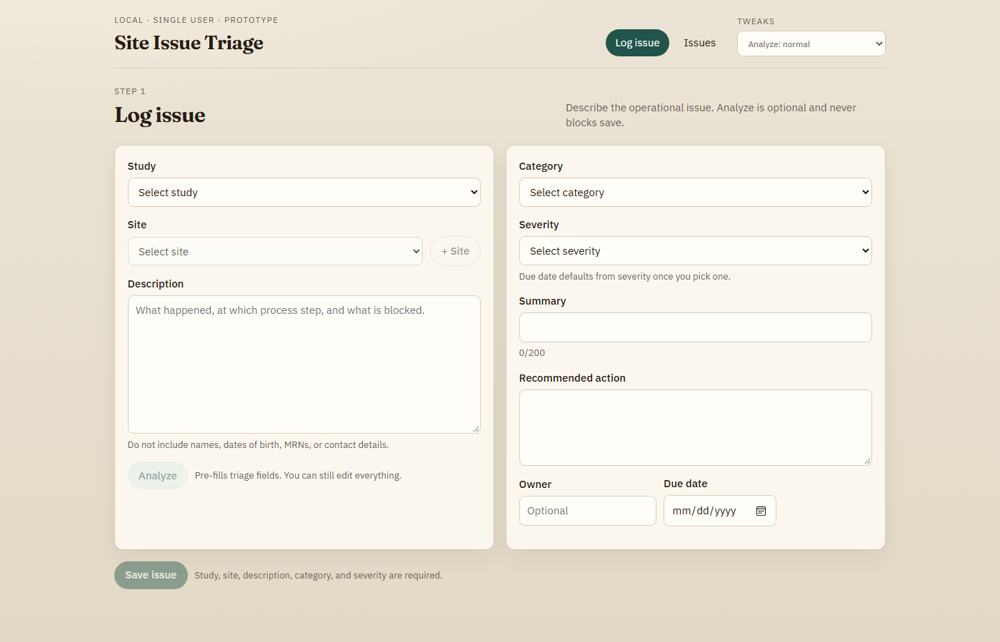
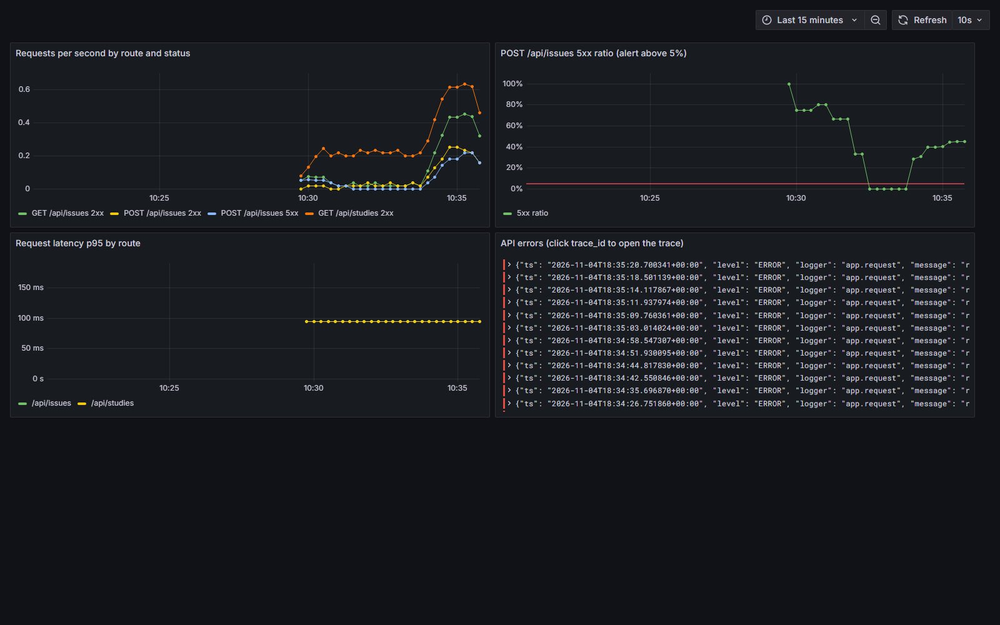

# Site Issue Triage Assistant - http://3.238.5.106/log

**AI Dev Tools Zoomcamp 2026 — Project 1.** A tool for a clinical-trial site manager to log operational issues in plain language, get an optional AI triage, and track each issue to resolution.

**Live at [http://3.238.5.106/log](http://3.238.5.106/log)** (AWS EC2)



## Problem

Site managers log issues as free text, then reconstruct category, severity, owner and next steps by hand. Intake is slow, lists are hard to scan, and the original judgment is lost once a record is edited.

## What it does

- **Log:** pick a study and site, describe the issue (no names, DOBs, MRNs or contact details).
- **Analyze (optional):**
  - pre-fills category, severity, summary, next step and a one-line rationale;
  - fields are tagged **AI**, and **EDITED** once changed;
  - a failed Analyze never blocks saving.
- **Track:**
  - a list sorted by severity, then oldest;
  - filters, overdue dates in red, CSV export;
  - due dates default from severity.
- **Resolve:**
  - edit any field, compare it with the original AI suggestion, append notes;
  - resolving requires a note.
- **Scope:** single user, no auth, operational issues only. No clinical advice, causality or dosing.

## Architecture and why

| Choice | Why |
|---|---|
| **Frontend first** (React + Vite), then an **OpenAPI contract** ([`openapi.yaml`](./openapi.yaml)) | The UI defined what the backend must do; one contract keeps both in sync and stops scope creep |
| **FastAPI** | Typed validation and auto-generated API docs; small and fast for a single-user MVP |
| **SQLAlchemy**: SQLite locally, Postgres in Compose and production | Zero-setup development, a production-grade database, same code (`DATABASE_URL`) |
| **One container** serves the API and the built UI | Same origin (no CORS); one image to build, test and deploy |
| **Separate dev and prod Compose stacks** | Isolated ports, volumes and config that mirror production |
| **CI gates → GHCR image → dev deploy → approved prod deploy** | Only tested images ship; dev is checked first; a human approves production |
| **OpenTelemetry + Prometheus** (Grafana, Tempo, Loki) | Open standards, no vendor lock-in; trace IDs in logs link a failure to its trace |
| **One alert on failed saves**, routed to a coding agent | Saving issues is the core function; the agent speeds up diagnosis, while fixes still go through PR, CI and approval |

## Run

| Command | What |
|---|---|
| `make run` + `make dev` | API on :8000 (Swagger at `/docs`) and UI on :5173, in two terminals |
| `make up` / `make down` | Dev stack (API + Postgres) on :8000 |
| `make up-prod` / `make down-prod` | Production stack on :8080 |
| `make up-obs` / `make down-obs` | Dev stack plus Grafana :3000, Prometheus :9090, Loki :3100, Tempo |

- **Overrides:** `VITE_API_URL` (API address for the UI) and `DATABASE_URL` (database; default `sqlite:///./triage.db`).
- **Ports:** set `API_PORT`, `GRAFANA_PORT`, `PROMETHEUS_PORT` or `LOKI_PORT` if the defaults are taken.
- **Seed data:** sample studies and sites load once, when the database is empty.
- **Testing a failed Analyze:** the header **Tweaks** control forces Analyze to "unavailable", to confirm Save still works.

## Tests

| Command | What |
|---|---|
| `make test-all` | **Everything:** starts Compose, waits for the API, runs unit + integration tests, tears down (same as CI) |
| `make test` | Backend unit tests (in-process, in-memory SQLite) |
| `make test-integration` | HTTP tests against a running stack (`INTEGRATION_BASE_URL`, default `http://127.0.0.1:8000`) |

## CI / CD

[`.github/workflows/ci.yml`](./.github/workflows/ci.yml):

```
test + compose ─► publish (GHCR :prod, :<sha>) ─► deploy-dev (auto, :8081) ─► deploy-prod (approval, :80)
integration (make test-all) runs on every push
```

- **On every push:** unit tests, Compose validation and `make test-all`.
- **On `master`:** the tested image goes to GHCR, deploys automatically to a dev stack on EC2 (`docker compose pull && up -d` over SSH, then a health check), and then, after a required reviewer approves, the same image goes to production.
- **Deploy configuration:** jobs run once the `EC2_HOST` variable and `EC2_SSH_KEY` secret are set ([`docs/deployment.md`](./docs/deployment.md)).

## Observability

- **Traces:** OpenTelemetry auto-instrumentation of FastAPI, exported to Tempo.
- **Logs:** one JSON line per request, with `trace_id`, route, status and duration, collected into Loki. In Grafana, a log line's trace ID opens its trace.
- **Metrics:** `/metrics` for Prometheus, plus a provisioned Grafana dashboard.
- **Alert:** `CreateIssue5xxRateHigh` fires when more than 5% of `POST /api/issues` return 5xx for a minute ([`alerts.yml`](./ops/observability/alerts.yml)). `make alert-demo` makes half of saves fail on purpose, to see it fire.
- **Alert → coding agent:** `make poll-alerts` ([`poll_alerts.py`](./scripts/poll_alerts.py)) turns each firing alert into an incident brief (5xx logs and trace IDs) and passes it to `ALERT_AGENT_CMD`, for example `claude -p`. The brief tells the agent not to push or deploy. [Example brief](./docs/observability/example-alert-brief.md).



- **Evidence:** screenshots of the logs, a matching trace, the firing alert and the scrape target are in [`docs/screenshots/observability/`](./docs/screenshots/observability/README.md).
- **Scope:** the stack runs locally with the dev setup, not on the live site. See the [best practice for a live site](./docs/implemented-improvements.md#best-practice-observability-for-a-live-site).

## Docs

| | |
|---|---|
| Product | [Spec](./docs/spec.md) · [Decision log](./docs/tasks.md) · [How we built it](./docs/how-we-built-it.md) |
| Process | [PM → SWE → QA](./docs/process.md) · [Permissions](./docs/permissions.md) · [Extension pack](./docs/extension-pack.md) · [Agent instructions](./AGENTS.md) |
| Delivery | [Deployment](./docs/deployment.md) · [Improvements and best practice](./docs/implemented-improvements.md) · [Criteria log](./docs/criteria-log.md) · [Issues](https://github.com/nghuixin/ai-dev-tools-zoomcamp-2026-project-1/issues?q=is%3Aissue) |

## Out of scope

CTMS/EDC integration, authentication, email ingestion, CAPA workflow, clinical decision support, notifications and duplicate detection. Alerts are operations tooling, not product notifications.

## Success (MVP)

- The full flow works and data survives a restart.
- In a 30-issue pilot: ≥70% of AI categories and ≥60% of severities saved unchanged; median log time ≤ 2 minutes.

## Learning in public

[Project notes on Notion](https://nghuixin.notion.site/Clinical-Trial-Site-Issue-Triage-Assistant-3f072266c5fb80a8b500d9331f392def)
