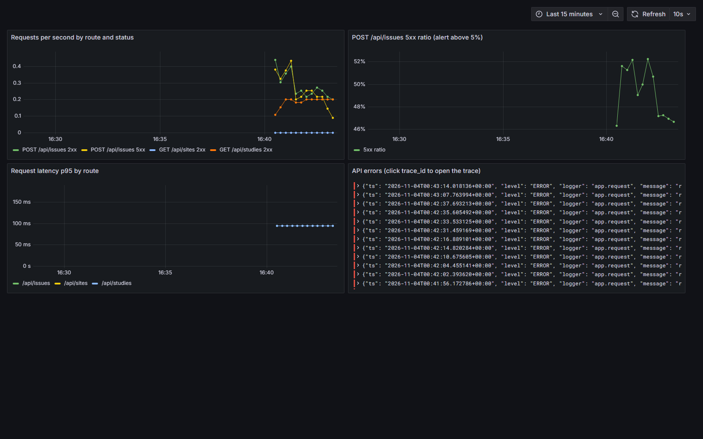

# Site Issue Triage Assistant

Local MVP for a single site manager: log a free-text site issue, optionally get an editable AI triage, save it, and track it to resolution.

This repository is **AI Dev Tools Zoomcamp 2026 — Project 1**. It is **frontend-first**: the UI was built first, then [`openapi.yaml`](./openapi.yaml) became the frontend/backend contract, then FastAPI implemented that contract. The API persists with SQLAlchemy (SQLite by default, Postgres-ready).

## Problem

Site managers log operational issues as free text and then reconstruct category, severity, owner, and next steps by hand. Intake is slow, lists are hard to scan, and the original judgment trail is lost when a record is later edited.

This project exists so a site manager can describe an issue in their own words, get an optional AI triage, edit and save it, and track it to resolution without that extra reconstruction work.

## What it does

A site manager picks a study and site, describes an operational issue, and can run **Analyze** to pre-fill category, severity, summary, recommended action, and a one-line rationale. The form stays editable. AI failure never blocks saving.

Saved issues appear in a filterable list (severity, site, summary, status, owner, due date, age). From detail, any field can be edited, status can change, and notes can be appended. Resolving an issue requires a resolution note.

Issues are stored via SQLAlchemy (seeded once when the database is empty). Default is SQLite (`DATABASE_URL` can point at Postgres later). There is no auth, no multi-user access, and no patient data.

## Run locally

Use two terminals. Start the backend first.

```bash
make run    # API on http://127.0.0.1:8000  (Swagger at /docs)
make dev    # frontend on http://localhost:5173
```

Without Make: `cd backend && uv sync && uv run uvicorn app.main:app --reload --port 8000`, then `cd frontend && npm install && npm run dev`.

The UI calls `http://127.0.0.1:8000` (`VITE_API_URL` overrides that). Default database is `sqlite:///./triage.db` (`DATABASE_URL` overrides that). Seeded sample data is inserted only when the database is empty.

The header **Tweaks** control can force Analyze to **unavailable** so you can confirm Save still works.

## Docker Compose

Two independent stacks (same services, separate project names, volumes, and ports):

| Command | File | Site |
|---|---|---|
| `make up` | `docker-compose.yaml` | [http://127.0.0.1:8000](http://127.0.0.1:8000) |
| `make up-prod` | `docker-compose.prod.yaml` | [http://127.0.0.1:8080](http://127.0.0.1:8080) |

They can run at the same time. `make down` / `make down-prod` stop that stack and keep its volume.

After CI publishes the image, a host can pull and run it by hand: set `PROD_IMAGE=ghcr.io/<owner>/<repo>/site-issue-triage:prod`, then `docker compose -f docker-compose.prod.yaml pull && docker compose -f docker-compose.prod.yaml up -d`.

Single-container image without Postgres (SQLite inside the container): `make image` then `docker run --rm -p 8000:8000 site-issue-triage`.

Dev stack host ports are configurable (`API_PORT`, `GRAFANA_PORT`, `PROMETHEUS_PORT`, `LOKI_PORT`) if the defaults are taken.

## Live deployment

**Live at [http://3.238.5.106/log](http://3.238.5.106/log)** — the production Compose stack on AWS EC2. CI/CD's deploy jobs update it once the EC2 secrets are configured (see [CI / CD](#ci--cd)).


## Tests

| Command | What it hits |
|---|---|
| `make test-all` | **Everything, one command:** starts Compose, waits for the API, runs unit + integration tests, tears down (same as CI) |
| `make test` | Backend unit tests (`backend/tests/`) — in-process FastAPI + in-memory SQLite |
| `make test-integration` | HTTP tests (`tests/integration/`) against a **running** Compose stack |

`make test-all` uses its own Compose project (`site-issue-triage-test`), so it does not stop a `make up` stack; set `API_PORT` if 8000 is taken.

To run integration tests against a stack you started yourself, bring up the dev stack and set `INTEGRATION_BASE_URL` (default `http://127.0.0.1:8000`):

```bash
make up
# another terminal
set INTEGRATION_BASE_URL=http://127.0.0.1:8000
make test-integration
```

On macOS/Linux: `INTEGRATION_BASE_URL=http://127.0.0.1:8000 make test-integration`.

## CI / CD

One workflow: [`.github/workflows/ci.yml`](./.github/workflows/ci.yml).

```
test ─┐
      ├─► publish (GHCR :prod, :<sha>) ─► deploy-dev (auto) ─► deploy-prod (approval)
compose ┘
integration (make test-all) — runs on every push, does not gate publish
```

- **Every push, PR and dispatch:** unit pytest, Compose validation (including the observability profile) and `make test-all`.
- **On `master` / `main`:** after tests pass, `publish` pushes the image to GHCR.
- **`deploy-dev`** SSHes to EC2 and runs `docker compose pull && up -d` for a dev stack on port 8081, then checks health.
- **`deploy-prod`** runs in the protected `production` environment: a required reviewer approves, then the same image (`:<sha>`) is rolled out to the live stack.
- Deploys need the `EC2_HOST` variable and `EC2_SSH_KEY` secret and are skipped until they're set. Setup: [`docs/deployment.md`](./docs/deployment.md).

## Observability

`make up-obs` starts the dev stack plus Grafana, Tempo, Loki (fed by Alloy) and Prometheus:

| | URL | What |
|---|---|---|
| Grafana | [http://127.0.0.1:3000](http://127.0.0.1:3000) | Dashboard **Site Issue Triage API**; Explore for logs and traces |
| Prometheus | [http://127.0.0.1:9090](http://127.0.0.1:9090) | Metrics and the `CreateIssue5xxRateHigh` alert |

- **Traces:** OpenTelemetry auto-instruments FastAPI and exports to Tempo.
- **Logs:** every request is one JSON line with `trace_id`, method, route, status and duration. In Grafana, a log line's trace ID links to the trace.
- **Metrics:** `/metrics` (Prometheus format, not part of the OpenAPI contract).
- **Alert:** `CreateIssue5xxRateHigh` fires when more than 5% of `POST /api/issues` return 5xx for a minute ([`ops/observability/alerts.yml`](./ops/observability/alerts.yml)). `make alert-demo` restarts the API with half of creates failing (`FAULT_CREATE_ISSUE_500_RATE=0.5`) to see it fire.
- **Alert → coding agent:** `make poll-alerts` runs [`scripts/poll_alerts.py`](./scripts/poll_alerts.py). It polls Prometheus, gathers the matching 5xx logs and trace IDs from Loki, writes an incident brief to `.alerts/`, and hands it to `ALERT_AGENT_CMD` (for example `claude -p`). Without an agent it prints the brief. [Example brief](./docs/observability/example-alert-brief.md).



## Expected behavior

1. Pick study and site (seeded lists; a site can be added inline).
2. Describe the issue (required). Hint: no names, DOBs, MRNs, or contact details.
3. Optionally run **Analyze**. Filled fields show an **AI** tag, which flips to **EDITED** if you change them.
4. Edit the form and save (category and severity required). Analyze failure does not block save.
5. Find the issue in the list. Default sort is severity, then oldest. `RESOLVED` is hidden unless you filter to it. Overdue dates are red. **Export CSV** uses the current filters.
6. Open detail: edit fields, compare against the original suggestion, move status in any order, append notes. Resolving requires a note and sets `resolved_at`.

## Docs

- Product spec: [`docs/spec.md`](./docs/spec.md)
- Decision log: [`docs/tasks.md`](./docs/tasks.md)
- How we built it: [`docs/how-we-built-it.md`](./docs/how-we-built-it.md)
- Process (PM → SWE → QA): [`docs/process.md`](./docs/process.md)
- Permissions: [`docs/permissions.md`](./docs/permissions.md)
- Extension pack: [`docs/extension-pack.md`](./docs/extension-pack.md)
- Criteria log: [`docs/criteria-log.md`](./docs/criteria-log.md)
- Deployment setup: [`docs/deployment.md`](./docs/deployment.md)
- What was added for deployment, testing, issues and observability: [`docs/implemented-improvements.md`](./docs/implemented-improvements.md)
- Issues with acceptance criteria: [GitHub Issues](https://github.com/nghuixin/ai-dev-tools-zoomcamp-2026-project-1/issues?q=is%3Aissue)
- API contract: [`openapi.yaml`](./openapi.yaml)
- Agent instructions: [`AGENTS.md`](./AGENTS.md)

Course extras live under [`.agents/`](./.agents/): skills plus PM / SWE / QA role files. They do not add product features.

## Constraints

| | |
|---|---|
| Users | Single site manager |
| Runtime | Vite frontend + FastAPI + SQLAlchemy (SQLite default) |
| Auth | None |
| Data | Operational site issues only — not real patient data |

Analyze output is operational next steps only. No clinical advice, causality, or dosing guidance.

## Out of scope

CTMS/EDC integration, authentication, email ingestion, CAPA workflow, clinical decision support, notifications, and duplicate detection. (Alerts and the alert poller are operations tooling, not product notifications.)

## Success (MVP)

- Full flow works and data survives restart.
- In a 30-issue pilot: ≥70% of AI categories and ≥60% of severities saved unchanged; median log time ≤ 2 minutes.

## Learning in Public
- https://nghuixin.notion.site/Clinical-Trial-Site-Issue-Triage-Assistant-3f072266c5fb80a8b500d9331f392def
